# Posters of *VP ≠ VNP over every field* and its Lean formalization

Fifteen generated SVG posters of the paper and of the vp-vnp folder of
[anthropics/formal-math](https://github.com/anthropics/formal-math/tree/main/vp-vnp), read at one pinned commit
(`FM_COMMIT` in `src/vp.py`). They have clickable links, adapt to light and dark, and are meant to be opened on their
own and zoomed.

Nothing here builds the Lean source. The posters read the Lean as text: every file of vp-vnp at the pin. They read the
paper's Table 1, Table 3, statement headers and the statements of Sections 1 and 2 from `src/paper-facts.json`, which
was read from `paper.pdf` once, outside the build. They read the uses between statements in the elaborated Lean from
`src/lean-uses.json` and `src/lean-modules.json`, which were read once from a build of vp-vnp at the pin, also outside
the build (`tools/lean-uses/README.md`). Each of these files is pinned by its hash.

## The posters

**Start here.**
- [R1](R1-main-theorems-2026.11.25.svg) for what is claimed
- [R2](R2-sections-2026.11.25.svg) for orientation
- [R3](R3-route-2026.11.25.svg) for the route from the main theorems down
- [F1](F1-paper-lean-2026.11.25.svg) for every numbered statement beside its Lean
- [F9](F9-text-lean-2026.11.25.svg) for how the uses were read

Three families; the table below names each poster.

- Read the proof at one level each: [R1](R1-main-theorems-2026.11.25.svg), [R2](R2-sections-2026.11.25.svg),
  [R3](R3-route-2026.11.25.svg)
- Follow one chain as a proof: [T1](T1-trace-contracting-2026.11.25.svg) the longest,
  [T2](T2-trace-flat-2026.11.25.svg) the longest through the flat case
- View from different frames of reference: [F1](F1-paper-lean-2026.11.25.svg), [F2](F2-modules-2026.11.25.svg),
  [F3](F3-formalization-notes-2026.11.25.svg), [F4](F4-figure-1-2026.11.25.svg), [F5](F5-library-2026.11.25.svg),
  [F6](F6-differences-2026.11.25.svg), [F7](F7-vocabulary-2026.11.25.svg), [F8](F8-literature-2026.11.25.svg),
  [F9](F9-text-lean-2026.11.25.svg), [F10](F10-files-2026.11.25.svg)

[](R2-sections-2026.11.25.svg)

| Id | Poster | What it shows |
|---|---|---|
| R1 | [What is claimed](R1-main-theorems-2026.11.25.svg) | The five theorems of `Solution.lean` that Comparator checks, each with the numbered statement of the paper whose Lean theorem its proof names, the 13 definitions of `Statement.lean` they are stated with, and where the paper's introduction states each result. |
| R2 | [The proof, section by section](R2-sections-2026.11.25.svg) | The 15 sections of the appendix as cards, coloured by the case each serves (flat, contracting or both), and Table 1's 30 uses between them set against the uses the elaborated Lean shows: 23 in both, 7 only in Table 1, 9 only in the Lean. |
| R3 | [The route to the main theorems](R3-route-2026.11.25.svg) | The 54 statements on the route of Solution's theorems as a graph of the uses the elaborated Lean shows, with the longest chain; the 11 statements off the route, set against Appendix Q.3's list; and Appendix Q's claims about the route, each checked against the uses. |
| T1 | [The longest chain of uses](T1-trace-contracting-2026.11.25.svg) | 14 statements, one card each in reading order, from Corollary M.4 through the contracting sections, then C and A, down to Definition A.1. |
| T2 | [The longest chain through the flat case](T2-trace-flat-2026.11.25.svg) | 11 statements from Corollary M.4 through Theorem E.11 down to Definition A.1. It first meets T1's chain at Theorem C.1. |
| F1 | [The paper against the Lean](F1-paper-lean-2026.11.25.svg) | The 65 numbered statements of Table 3, row by row, each with its Lean theorems and their file and line, the label and the quotation of the paper in the first theorem's docstring, and the 124 uses between statements in the elaborated Lean. |
| F2 | [The proof as code](F2-modules-2026.11.25.svg) | The seven Lean libraries and the imports between them, counted and then the 126 import lines between libraries file by file; the 44 files of the Paper library, with the part of the paper each one's docstring names; and the 12 largest files. |
| F3 | [Where the paper rests on the Lean](F3-formalization-notes-2026.11.25.svg) | The overview's four statements whose proofs are left to the Lean, the paper's seven formalization notes, each placed in the text, and the Lean under each of the 64 statements that have a Lean theorem. |
| F4 | [The paper's own picture of the proof](F4-figure-1-2026.11.25.svg) | Figure 1 of the paper, transcribed box by box and arrow by arrow, with a verdict from the Lean uses for each of the 25 statements its arrows carry. |
| F5 | [Where the formal work is](F5-library-2026.11.25.svg) | The 25 directories of Nc, NS1 and Ov against the 14 sections whose statements reach them, with the lines each section's statements reach in each directory. |
| F6 | [Where the Lean and the text differ](F6-differences-2026.11.25.svg) | Every Lean name the paper prints, the 11 beyond Table 3, Appendix Q.3's universes set against the signatures, and Q.3's 15 listed differences, quoted. |
| F7 | [The two vocabularies](F7-vocabulary-2026.11.25.svg) | Appendix P's 17 coined terms and Appendix Q.3's 7 renamings, each word counted in the Lean's declaration names and in its source text. |
| F8 | [The proof as literature](F8-literature-2026.11.25.svg) | The 134 references by decade, where each of the 185 citations stands, and each entry linked to its paper, from `src/papers.toml`. |
| F9 | [The text against the Lean](F9-text-lean-2026.11.25.svg) | Every use between statements in the text reading and in the Lean reading (`src/lean-uses.json`), the uses only the Lean shows and the helper outside Paper behind each, and the second Lean reading, from the compiled modules (`src/lean-modules.json`), set against the first. |
| F10 | [The proof file by file](F10-files-2026.11.25.svg) | Every one of the 323 Lean files, by library and by F5's directories: its lines, its declarations, each linked to its line at the pin, and the files it imports and is imported by. A header row per library and directory, which F2's and F5's counts open. |

Each poster is a module `src/d_<id>_<slug>.py`. T1 and T2 share the trace layout of `src/trace.py`.

## Where the content comes from

[TEXT.md](TEXT.md) goes through every kind of text on a poster: what is quoted from the Lean and the paper, what is
computed, what is framing, and what is the poster's own interpretation, with the check that guards each.

| Source | Pinned by | Read by |
|---|---|---|
| The vp-vnp folder of anthropics/formal-math: every `.lean` file, `comparator.json`, `README.md` | `FM_COMMIT` in `src/vp.py`; the build fails on a checkout at another commit | `vp.load()` |
| `vp-vnp/paper.pdf` | `PAPER_SHA256`; the build fails if the file is present and hashes otherwise | `tools/paper-facts/extract.py`, outside the build |
| `src/paper-facts.json`: the paper's Table 1, Table 3, statement headers, and the statements of Sections 1 and 2 | `PAPER_FACTS_SHA256`, and `tools/paper-facts/meta.json`, which records the commit and both hashes | `vp.load()` |
| `src/papers.toml`: the paper behind each reference | this repository's own data, checked both ways against the references | `vp.load()`, F8 |
| `src/lean-uses.json`: the uses between statements in the elaborated Lean, from an export of vp-vnp built at the pin | `LEAN_USES_SHA256`, and `tools/lean-uses/meta.json`, which records the commit and the export's hash | `vp.load()`, F9 |
| `src/lean-modules.json`: the same uses read from the compiled modules by Lean itself, the second Lean reading | `LEAN_MODULES_SHA256`, and `tools/lean-uses/meta-modules.json` | `vp.load()`, F9 |

Which reading a poster draws: every poster that draws uses between statements, or the Lean under one (F1, F3, F4,
F5, R2, R3, T1, T2), reads the elaborated Lean (`src/lean-uses.json`, Phase 2: an export of vp-vnp built once at the
pin, read by `tools/lean-uses/read_export.py`). The text reading below is Phase 1's; F9 sets the two against each
other, and it is still how vp.py finds the source's declarations, files and lines.

How the Lean is read as text: comments and strings blanked, full names come from `namespace`, `section` and
`end`, and a declaration runs from its keyword at the head of a line to the next command at the head of a line. A
statement **uses** another when the text of one of its Lean theorems names one of the other's. It may name it
directly, or through declarations of the Paper library that belong to no statement. A name Table 3 gives two
statements (`Paper.scales_setting`, given to K.5 and K.6) is each one's own, but what it names of the other
co-owner is not counted as a use: it states the two together, in J.4's setting. Not seen: a use made
without the name (an instance, a `simp` set, a tactic that finds the lemma), or a name behind an `open`. A local
variable that shares a name with a theorem is counted as a use of it.

**What lies under a statement**, in the text reading (`vp.closure`, which no poster draws now), is read the same
way, across every library: the walk from the statement's own theorems through every declaration their text names,
stopping at the theorems of other statements. A token names a declaration when it is the declaration's full name, or
a dotted suffix of exactly one full name, in a file the naming file imports, and has at least three characters.

## What is checked

Each poster module records what it expects the sources to say as module-level literals, and the build fails when they
differ, in either direction: a value the sources have and the module does not record fails as much as one the module
records and the sources no longer have.

| Poster | The build fails if any of these differ from what the module records |
|---|---|
| R1 | the theorems `comparator.json` names, `Solution.lean` proves and `Challenge.lean` states (`CLAIMS`); the statement each is proved from (`CLAIMS`); the definitions (`DEFINITIONS`); Statement's and Challenge's imports; the introduction's statements and their rows of Table 3 (`INTRO`); the permitted axioms (`AXIOMS`); the README sentence it quotes (`QUOTED`) |
| R2 | each section's case (`CASES`); statements per section (`COUNTS`); Table 1's uses (`EXPECTED`); those the Lean bears out (`BORNE`); those only the Lean shows (`LEAN_ONLY`) |
| R3 | the uses drawn are F1's (`EXPECTED` of F1); the statements off the route (`OFF_ROUTE`); Q.3's list (`Q3_OFF`) and that it ends with "the definitions"; the one row of Q.3 the walk reaches, and the Lean name it reaches it by (`ON_BY_SECOND`); that the rest of the route agrees with Q.3; the longest chain (`CHAIN`); each claim of Appendix Q's "Routes of proof" quoted and its check (`ROUTE_CLAIMS`) |
| T1 | the chain (`CHAIN`), which must be R3's; that each step uses the next and the last uses nothing; that below L.1 it runs through the contracting sections, then C and A |
| T2 | the chain (`CHAIN`); that each step uses the next; that below E.11 it is the longest; that it first meets T1's at C.1 |
| F1 | the count and kinds (`N_STATEMENTS`, `KINDS`); the rows with no Lean theorem (`NOT_FORMALIZED`); the rows whose docstring does not open with the paper's kind and label (`NO_DOC_LABEL`); names given to two rows (`SHARED`); every use between statements (`EXPECTED`) and which are direct (`DIRECT`) |
| F2 | files, lines and declarations per library (`LIBRARY`); imports between libraries (`IMPORTS`), and the 126 import lines between them file by file (`ACROSS`); the files outside Paper that import a Paper file (`UPWARD`); the statements each Paper file declares (`STATEMENTS_IN`); the 12 largest files (`TOP`) |
| F3 | the overview's four (`OVERVIEW`); each note's page, place, names and statement (`NOTES`); the declarations and lines by library under each of 64 statements (`WEIGHT`) |
| F4 | the Lean names the figure prints (`FIGURE_NAMES`), which the transcription (`BOXES`, `ARROWS`) must use exactly; the row of Table 3 that is its Theorem 1.1 (`THEOREM`); the verdict on every statement an arrow carries (`VERDICTS`) |
| F5 | files, lines and declaration lines per directory (`DIRS`); the lines each section's statements reach in each directory (`MATRIX`); the lines of each directory some statement reaches (`REACHED`) |
| F6 | the count of printed names (`N_PAPER_NAMES`); those no file declares (`NOT_DECLARED`), and that no file uses them; those beyond Table 3 and their declarations (`BEYOND_TABLE3`); the universes of Q.3 and of the signatures (`UNIVERSES`); the stronger forms (`STRONGER`); each bullet's statements and Lean names (`DIFFERENCES`), every name declared |
| F7 | the glossary's terms and places (`GLOSSARY`); the renamings (`RENAMES`); each word's count in declaration names (`IN_NAMES`) and in the source text (`IN_TEXT`) |
| F8 | the number of references and citations (`N_REFS`, `N_CITATIONS`); where each reference is cited (`CITED`); that every reference has an entry in `src/papers.toml` and every entry names a reference (with `vp.load`), each with a url or a note saying why not |
| F9 | the export's counts (`LEAN_COUNTS`); the uses only the text shows (`TEXT_ONLY`, none) and those the two give different kinds (`KIND_DIFFERS`, none); the uses only the Lean shows (`EXPORT_ONLY`) and the helper outside Paper behind each (`OUTSIDE`); the uses between sections the Lean adds (`SECTIONS_ADDED`); the second Lean reading's counts (`MODULES_COUNTS`), that the two Lean readings give the same uses (`READINGS_DIFFER`, none), the export rule's false and missed constants (`RULE_FALSE`, `RULE_MISSED`), and where they find different declarations under a statement (`UNDER_DIFFERS`) |
| F10 | the files, lines and declarations of each library and each directory (`GROUPS`); not each file's, so a declaration renamed or replaced within a directory is not caught |

The build also fails, on any poster, if:

- the formal-math checkout is at another commit than `FM_COMMIT`;
- `vp-vnp/paper.pdf` is present and does not hash to `PAPER_SHA256`, or `src/paper-facts.json` does not hash to
  `PAPER_FACTS_SHA256`, or `tools/paper-facts/meta.json` does not record the pinned commit and hashes;
- `src/lean-uses.json` or `src/lean-modules.json` does not hash to its pin (`LEAN_USES_SHA256`,
  `LEAN_MODULES_SHA256`), or its meta file does not record `FM_COMMIT` and that hash;
- a Table 3 name is declared by no file;
- a declaration name is used twice outside `Challenge.lean`;
- a Lean file is outside the seven libraries;
- an entry of `src/papers.toml` names no reference of the paper, or has neither a url nor a note saying why;
- a title is wider than its card, a cell's word is wider than its cell, or two texts overlap;
- a character is outside the embedded fonts;
- a link names an id no poster draws, or a link out is not at the pinned commit.

## Links

The posters link to each other and to formal-math at `FM_COMMIT`. `Canvas.link()` (`src/lib.py`) makes every link
after the layout, so a link adds nothing to the measured text and moves nothing. A name links to where the set, or
the source, draws it:

| The text names | It opens |
|---|---|
| a statement number (`K.3`), or a display in parentheses (`(F.1)`) | its card on the same poster, else its row on F1; a display only where F1 has a row for it, so `(B.2)` stays text |
| a section (`Section K`, `Sections C and A`, `Appendix O`), or an appendix in F8's Cited in | its card on R2 |
| a directory (`Nc.Price`) | its card on F5 |
| a library, where a poster marks it (F2, F3, F5, F9, F10) | its card on F2 |
| a count of a library's files, lines and declarations on F2, or of a directory's on F5 | its header row on F10, above the files it counts |
| an import count on F2 (`Imports Nc (50)`, and the cells of its import table) | the import lines it counts, in F2's band 3; within one library, its files on F10 |
| a module (`Nc.Price.Cross`), in code or in plain text | its row on F10 |
| a reference's key (`Val79`) | its row on F8 |
| one of Solution's theorems or Statement's definitions, by its full name or, in code, by its last part | its card on R1 |
| another poster by its id, where a poster marks it (`R3 checks that sentence`) | that poster's title |
| a Lean declaration, by its full name, or by a short name that one declaration has and that is four letters or more, in code or as the paper prints one (a word with an underscore) | its line in formal-math at the pin |
| a file of vp-vnp by its path (`Paper/Tree.lean`), or a `file:line` | the file, or the line, at the pin |

A name stays text inside the card or row it would open, inside a Lean panel (which quotes code), and wherever it does
not resolve. A link to a poster is made only to an id the committed `manifest.json` lists, which the generator writes
with every poster's anchors; when a run moves any poster's anchors, it updates the manifest, prints a NOTE and exits
1, and the second run makes the links follow. A link to formal-math is made only to a declaration or file read at the
pin, and to a line that file has. These links leave the set, so they are absolute, and always at the pinned commit,
never a branch. `check-links.py` (proof-posters:linking-posters) checks that every link lands; at 2026.11.25 it counts
9,075 links: 1,465 to another poster, 1,797 within a poster, 5,681 to formal-math at the pin and 132 to the papers of
F8. That count is written here by hand.

A link's target is framed when it opens (CSS `:target`): a card by its halo, a table row by its own background, and
without the pulse under reduced motion. This works wherever a browser opens the SVG as a document (the Pages site, a
release asset, a file), not in GitHub's file viewer or inside an ``, which show an SVG as an image, without its
links.

Every colour is written twice: once as a presentation attribute, the light theme, and once as a CSS class that
switches under `prefers-color-scheme: dark`. A browser adapts; a renderer that runs no CSS draws the light theme and
never shows the halo. The light page, #eeeeee, is riemann-diagrams' measured grey (its `diagrams/PAGE.md`), not
measured again for these posters.

Not checked: that a short name in code is the declaration and not a local of the same name (hence only names of four
letters or more that one declaration has); that the framing works in Firefox and Safari (measured in Chrome).

## Regenerating

```bash
uv run python diagrams/gen-diagrams.py        # all; or: uv run python diagrams/gen-diagrams.py R3 F1
```

The generator needs only the standard library, on Python 3.12 or later. The output is deterministic: unchanged
inputs give unchanged bytes, so a diff in an SVG after regenerating means formal-math or a pinned file has moved
under a poster. Any line it prints starting with `WARNING` or `ERROR` is a failure. After a change, look at the result
in both themes.

The links between posters are resolved against the committed `manifest.json`. When a run moves a poster's anchors it
updates the manifest, prints a NOTE and exits 1: run it again, so that the links of every poster follow. A run whose
anchors did not move needs no second run.

To move the posters to a newer formal-math, bump `FM_COMMIT` in `src/vp.py`, regenerate, and fix whatever the checks
report by recording what the source now says (proof-posters:moving-pins). A new `paper.pdf` stops the build on
`PAPER_SHA256` until `src/paper-facts.json` is read again (`tools/paper-facts/README.md`), and a moved pin stops it on
`LEAN_USES_SHA256` and `LEAN_MODULES_SHA256` until the Lean files are rebuilt (`tools/lean-uses/README.md`).

The source is the vp-vnp folder of a formal-math checkout: `../vp-np` by default, or the folder `VP_VNP` names.

## In CI

`.github/workflows/posters.yml`, on every push to main and every pull request, checks out only the vp-vnp folder of
formal-math at `FM_COMMIT`, regenerates every poster with Python 3.12, and fails if the generator prints a `WARNING`
or `ERROR`, if any committed SVG differs from the regenerated one, or if a poster is regenerated that is not
committed. It then runs the proof-posters plugin's checks from riemann-diagrams at `PROOF_POSTERS_COMMIT`
(proof-posters 0.4.2): `check-expectations.py --strict` (every recorded name is a literal, assigned once and read),
`check-links.py` (every link lands) and `determinism.py` (two rounds, `PYTHONHASHSEED` 0 and 1, the same bytes). So a
pull request that moves the pin without regenerating fails, and one that regenerates passes.
`.github/workflows/sources.yml` runs daily and fails when formal-math's main has commits after `FM_COMMIT` that touch
vp-vnp, or when the pin is no longer on main; it only reports.

## Files

| File | What it is |
|---|---|
| `gen-diagrams.py` | the generator; writes the posters and `manifest.json` |
| `manifest.json` | one entry per poster: its file, title, card and arrow counts, its anchors and its links; the registry the links between posters are resolved against |
| `src/vp.py` | the pins, the commit and hash checks, the Lean reader, the card |
| `src/lib.py` | the drawing library: measured and wrapped text, cards, tables, arrows, links, two themes |
| `src/fonts/`, `src/metrics.py` | the Noto faces every poster embeds, and their advance widths (see Fonts, below) |
| `src/d_*.py` | one module per poster, holding what it expects the sources to say |
| `src/trace.py` | the trace poster: one chain of uses as cards, for T1 and T2 |
| `src/paper-facts.json` | the facts of the paper, written by `tools/paper-facts/extract.py` |
| `src/lean-uses.json` | the uses between statements in the elaborated Lean, written by `tools/lean-uses/read_export.py` (Phase 2) |
| `src/lean-modules.json` | the same uses read from the compiled modules, the second Lean reading (`tools/lean-uses/`) |
| `src/papers.toml` | the paper behind each reference, with how it was found (proof-posters:linking-papers); this repository's own data |
| `TEXT.md` | what on a poster is quoted, computed, framing or its own |

`lib.py`, `metrics.py` and `tools/build-fonts.py` are taken from riemann-diagrams (Apache-2.0, same author). `lib.py`
differs in the brand, the date, the order in which a link finds a poster's card (`HOME_ORDER`), and has no map mode.

## Fonts

Every poster carries its fonts: Noto Sans (regular, bold, italic) for the text, Noto Sans Mono (regular, bold) for
code and Lean, and Noto Sans Math for the symbols the other two lack, each subset and embedded as WOFF2 in the
poster's `<style>`. `src/metrics.py` holds the advance width of every character in every face, so text is wrapped and
boxed at the width it is drawn in. A character outside the subsets is a WARNING, which fails the build, rather than a
silent fallback to a system font.

`tools/build-fonts.py` writes `src/fonts/*.woff2` and `src/metrics.py` from the Noto sources in google/fonts, pinned
by commit and SHA-256 in the script. It needs fontTools and Brotli; the generator does not, since it only base64-encodes the
committed files. Run it to add characters (its `WANT`) or change a face, then regenerate the posters:

```
uv run --with fonttools==4.68.0 --with brotli==1.2.0 python tools/build-fonts.py SRC_DIR
```

The fonts are under the SIL Open Font License 1.1, Copyright 2022 The Noto Project Authors (`src/fonts/OFL.txt`).

## Attribution

* **The paper and the formalization**, *VP ≠ VNP over every field* (`vp-vnp/paper.pdf`) and its Lean source, are
  the vp-vnp folder of [anthropics/formal-math](https://github.com/anthropics/formal-math), Copyright 2026
  Anthropic, PBC, under the Apache License 2.0. Its README says of them: "Both were written by AI models, and no
  human mathematician has checked the proof." The posters quote the Lean source, the README and the paper, and
  those quotations stay under that licence ([NOTICE](../NOTICE)).
* **[Lean](https://lean-lang.org)** and **[Mathlib](https://github.com/leanprover-community/mathlib4)** underlie the
  formalization. The export the Lean reading comes from was made with
  [lean4export](https://github.com/leanprover/lean4export) (`tools/lean-uses/README.md`).
* **The papers F8 links to** were found through Crossref and zbMATH Open, or by hand where they did not settle it,
  as each entry of `src/papers.toml` records.
* **The method**, the proof-posters plugin, and the drawing library are from
  [riemann-diagrams](https://github.com/scottcochran/riemann-diagrams), by the same author as this repository.
* **The Noto fonts** every poster embeds are Copyright 2022 The Noto Project Authors, under the SIL Open Font
  License 1.1 (`src/fonts/OFL.txt`).

A poster here says nothing of its own about whether the proof or its formalization is correct. They are read from
the source text, the paper and an export of the built Lean; the posters build no Lean themselves.
